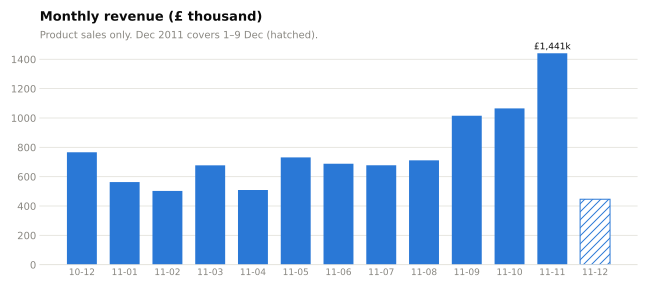
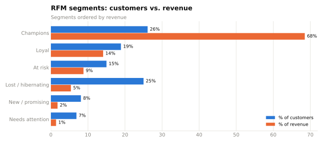
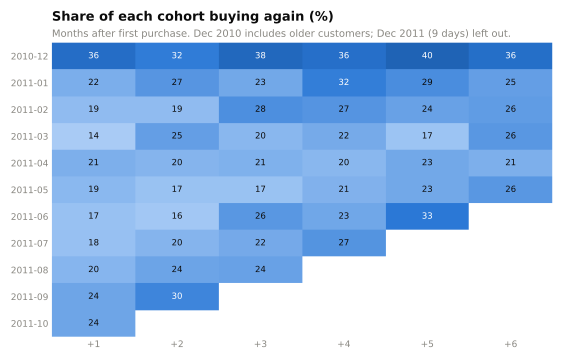

# E-commerce SQL Case Study

**Who are the valuable customers of a UK online gift retailer, when do they buy, and what should the business do about it?**
SQL analysis of **541,909 transaction lines** (Dec 2010 – Dec 2011), fully reproducible with one command.



## Key results

| Question | Answer |
|---|---|
| How concentrated is revenue? | The **top 10 % of customers bring 60 %** of revenue; the top 1 % alone bring 30 %. |
| Who are the best customers? | RFM "Champions" are **26 % of customers but 69 % of revenue** (median 7 orders, last order 11 days before the data ends). |
| How much revenue is at risk? | **629 "At risk" customers** (bought often, but not for a median of 144 days) represent **£724k**, 8.7 % of revenue. |
| Do customers come back? | **65 %** of customers ordered more than once. Of each new monthly cohort, only **~20 % order again the next month**. |
| When do people buy? | Strong Q4 peak: **November is 2.9× February**, and Sep–Nov bring 38 % of the revenue of the 12 full months. Orders peak at **12:00**; there are **no sales on Saturdays**. |
| What kind of customers are these? | Median order is **£301 with 15 different products**, which looks like small retailers buying wholesale rather than consumers. |
| Which products matter? | **251 of 3,902 products make half of all revenue**; the top 20 % of products make 78 %. |
| Where are the customers? | The UK is 85 % of revenue. The Netherlands (9 customers, £282k) and Ireland (3 customers, £256k) are a few very large accounts. |

Full write-up with recommendations: [analysis/key_findings.md](analysis/key_findings.md)

<p>


</p>

## Data cleaning decisions

Real transaction data needs decisions, and each one changes the numbers. They are all in one place, [`sql/01_clean.sql`](sql/01_clean.sql), and counted in [`sql/02_data_quality.sql`](sql/02_data_quality.sql):

| Issue | Rows | Decision |
|---|---:|---|
| Missing CustomerID | 135,080 (25 %) | Kept for revenue and product analysis, excluded from customer analysis (RFM, cohorts) |
| Cancellations (invoice starts with `C`) | 9,288 | Analysed separately, not counted as sales |
| Quantity ≤ 0 or price ≤ 0 | 10,624 / 2,517 | Excluded from sales |
| Postage, fees, discounts, vouchers | 2,950 | Excluded: not products |
| Sales reversed by an exact matching cancellation | 4,032 | Excluded. Without this rule, one order of **80,995 paper birdies** and one of **74,215 storage jars**, both cancelled immediately, would rank as the top products |
| Exact duplicate rows | 5,268 | Kept: identical lines inside one invoice can be real (the same item scanned twice), and the data has no line ID to prove otherwise |

Result: **523,780 product sale lines** (392,359 with a customer ID), **£9.79M revenue**.

## How to run

```bash
pip install -r requirements.txt
python run_analysis.py
```

The script downloads the data (if missing), runs every SQL file in order with [DuckDB](https://duckdb.org) (standard SQL, no database server needed), saves each query result to [`results/`](results/) and redraws the charts. Every number in this README comes from a file in `results/`.

## SQL files

| File | What it does | SQL used |
|---|---|---|
| [`01_clean.sql`](sql/01_clean.sql) | Load the CSV, define the cleaning rules once as views | views, `NOT IN`, self-join to find reversed sales |
| [`02_data_quality.sql`](sql/02_data_quality.sql) | Count every removed row and why; sales by weekday | `UNION ALL`, `DISTINCT` |
| [`03_revenue_trends.sql`](sql/03_revenue_trends.sql) | Monthly revenue, orders, AOV; hourly pattern; order size | `date_trunc`, `MEDIAN`, `quantile_cont` |
| [`04_customers_rfm.sql`](sql/04_customers_rfm.sql) | RFM scores and segments, revenue concentration, repeat rate | CTEs, `NTILE`, window `SUM() OVER ()`, `FILTER` |
| [`05_cohort_retention.sql`](sql/05_cohort_retention.sql) | Monthly cohorts and how many buy again | CTEs, `date_diff`, cohort join |
| [`06_products_countries.sql`](sql/06_products_countries.sql) | Top products, Pareto share, cancellations, countries | `ROW_NUMBER`, running totals |

## Limitations

- **One retailer, one year.** Seasonality is based on a single Q4.
- **Recency is relative to the end of the data** (10 Dec 2011), not to today.
- **The Dec 2010 cohort is not a real "new customer" cohort**: the data starts then, so it also contains long-time customers. That is why its retention looks much higher.
- **December 2011 covers only 9 days**, so it is shown as partial and left out of the retention chart.
- **Revenue is gross product sales** in GBP, without costs or margins, so recommendations are about revenue, not profit.
- RFM segment rules are a common convention, not fitted to this business.

## Data

[UCI Machine Learning Repository: Online Retail](https://archive.ics.uci.edu/dataset/352/online+retail) by Daqing Chen (2015), licensed CC BY 4.0. The script downloads the CSV copy published in the [Spark: The Definitive Guide](https://github.com/databricks/Spark-The-Definitive-Guide) repository. The data is not stored in this repo.

---

**Author:** Sachini Hewahattage · [LinkedIn](https://www.linkedin.com/in/sachini-hewahattage) · [GitHub](https://github.com/Sachinisand)
